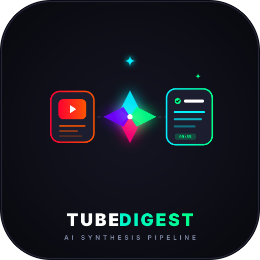
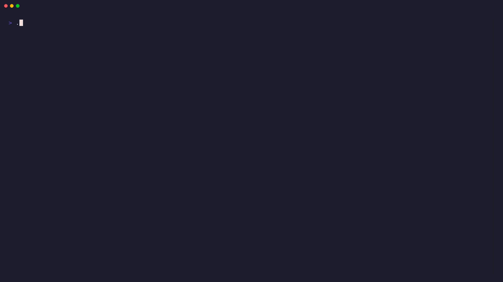

<p align="center">
  
</p>

<h1 align="center">TubeDigest</h1>

<p align="center">
  <b>Automated YouTube Monitor &amp; Gemini AI Digest Pipeline</b><br>
  <i>Lightweight, quota-free YouTube channel tracking with structured AI summaries delivered straight to your inbox.</i>
</p>

<p align="center">
  <a href="https://www.python.org/downloads/"></a>
  <a href="https://ai.google.dev/"></a>
  <a href="https://www.sqlite.org/"></a>
  <a href="DEVELOPMENT_METRICS.md"></a>
  <a href="LICENSE"></a>
</p>

**TubeDigest** is a lightweight, headless Python automation pipeline designed to run seamlessly on Linux servers or Raspberry Pi devices. 

It continuously monitors multiple YouTube channels via RSS feeds, downloads new video transcripts, produces structured, high-quality Markdown summaries using the Google Gemini API, and dispatches formatted HTML email digests directly to your inbox. All channel subscriptions, transcripts, and summaries are persistently managed through a lightweight local **SQLite** database.

<p align="center">
  
</p>

> [!WARNING]
> ### ⚠️ Target Audience & Disclaimer (Read Before Using)
> **TubeDigest is an open-source utility tailored for tech-savvy users, developers, and self-hosters ("smanettoni").**
> 
> * **Technical familiarity required**: Setting up and running this pipeline requires basic familiarity with the Linux CLI, Python virtual environments, editing configuration files (`config.toml`), generating third-party API keys (Google AI Studio), managing SMTP Application Passwords, and configuring background tasks (`cron`).
> * **Not a plug-and-play desktop app**: This is a headless automation script, not a consumer application with a graphical wizard or 24/7 technical support. A minimum level of technical autonomy and troubleshooting skill is assumed.
> * **"As-Is" & Disclaimer of Liability**: This software is provided free and "as is", without warranty of any kind, express or implied. The author assumes no responsibility or liability for email delivery issues, API quota usage or costs incurred on third-party services (Google AI Studio), or unintended data modifications. Use at your own discretion.

---

## 🚀 Key Features

* **Multi-Channel Management**: Monitor as many YouTube channels as you want, easily managed via CLI commands.
* **Quota-Free Channel Tracking**: Monitors YouTube channels via standard RSS feeds—no complex YouTube Data API credentials or quota limits required.
* **Automatic Transcript Extraction**: Pulls subtitle and caption tracks automatically using `youtube-transcript-api` (supporting language fallbacks).
* **AI-Powered Summarization**: Generates insightful, structured summaries powered by Google's Gemini models (`gemini-2.5-flash`, `gemini-3.6-flash`, etc.).
* **Database-Driven Prompt Templates**: Prompt templates reside directly in SQLite (`prompts` table), allowing custom prompts per channel with zero loose files.
* **Built-in SQLite Storage**: Saves channel authors, prompts, transcripts, generated summaries, and channel states in a local SQLite database (`data/tubedigest.db`)—avoiding re-processing and saving AI tokens.
* **Separated Query Architecture**: All SQL statements reside in a dedicated `DatabaseQueries` class for clean maintainability.
* **Rich HTML Email Digests**: Delivers clean, responsive emails with video thumbnails, key takeaways in Markdown format, and direct YouTube links.
* **Resilient Logging & Friendly CLI**: Clean, human-friendly messages on terminal with all technical exceptions and stack traces routed cleanly to rotated log files (`logs/tubedigest.log`).
* **Headless & Cron-Ready**: Built for automated background execution on home servers, Linux VPS, or Raspberry Pi boards.

---

## 📁 Project Structure

```text
tubedigest/
├── assets/                  # Project media, animated showcase, and official vector logo
│   ├── logo.svg
│   └── demo.gif
├── docs/                    # Documentation and VHS recording scripts
│   └── demo.tape
├── config.example.toml      # Configuration template with placeholder values
├── config.toml              # Your active configuration (ignored by Git)
├── tubedigest               # Executable main application entry point & CLI manager
├── requirements.txt         # Python package dependencies
├── TECHNICAL_SPECIFICATIONS.md # Detailed architecture and engineering specs
├── DEVELOPMENT_METRICS.md   # Development effort, PM review, and AI telemetry report
├── data/                    # Local SQLite database directory (ignored by Git)
│   └── .gitkeep
├── core/
│   ├── __init__.py
│   ├── models.py            # Domain models and VideoStatus StrEnum
│   ├── ui.py                # ANSI terminal styling, banner, tables, and panels
│   ├── queries.py           # Centralized DatabaseQueries SQL store
│   ├── database.py          # SQLite DatabaseManager for channels, authors, prompts, and archives
│   ├── i18n.py              # Internationalization and localization service (I18nManager)
│   ├── state_manager.py     # Handles filesystem I/O and execution logs
│   └── tube_digest.py       # Core logic: RSS parsing, Gemini client, SMTP dispatch
└── logs/                    # Timestamped execution log files
```

---

## 🛠️ Prerequisites

* **Python 3.11 to 3.13** (see compatibility matrix below)
* A **Google Gemini API Key** (obtainable for free at [Google AI Studio](https://aistudio.google.com/))
* An **SMTP-enabled email account** (e.g., Gmail with an [App Password](https://myaccount.google.com/apppasswords))

### 🐍 Python Version Compatibility Matrix

| Python Version | Compatibility | Target Distributions & Technical Constraints |
| :--- | :---: | :--- |
| **Python $\le$ 3.10** | ❌ Incompatible | `google-genai` and `markdown` require `Python >= 3.11`. Installation is blocked by `pip`. |
| **Python 3.11.x** |  Fully Supported | Default on **Debian 12 Bookworm**, **Raspberry Pi OS**, etc. Fully compliant with pre-3.12 PEP 701 syntax constraints. |
| **Python 3.12.x** |  Fully Supported | Default on **Ubuntu 24.04 LTS**, Fedora 39/40, etc. |
| **Python 3.13.x** |  Fully Supported | Primary development runtime. Zero warnings or deprecation notices. |
| **Python 3.14 - 3.15** | ⚠️ Forward-Compatible | Application code is forward-compatible; depends on third-party binary wheels availability upon official releases. |
| **Python $\ge$ 3.16** | ❌ Incompatible | Upper boundary enforced by `youtube-transcript-api` package metadata (`<3.16`). |

---

## 📦 Installation & Setup

### 1. Clone the Repository

```bash
git clone https://github.com/melo70/tubedigest.git
cd tubedigest
```

### 2. Create and Activate a Virtual Environment

```bash
python3 -m venv .venv
source .venv/bin/activate
```

### 3. Install Dependencies

```bash
pip install -r requirements.txt
```

### 4. Configure Application Settings

Copy the sample configuration file to `config.toml`:

```bash
cp config.example.toml config.toml
```

Edit `config.toml` with your credentials:

```toml
[general]
# Global default language for AI summaries (e.g. "en", "it", "es", "fr", "de", "zh", "hi", "ja").
# Channels can override this via CLI using --lang.
language = "en"

[youtube]
feed_url_template = "https://www.youtube.com/feeds/videos.xml?channel_id={channel_id}"

[email]
sender = "your.email@gmail.com"
password = "your-16-char-app-password"
receiver = "destination.email@gmail.com"
smtp_server = "smtp.gmail.com"
smtp_port = 587

[storage]
db_path = "data/tubedigest.db"
logs_dir = "logs"
log_file = "tubedigest.log"
log_max_bytes = 1048576       # 1 MB before rotation
log_backup_count = 5          # Number of rotated backups to keep

[gemini]
api_key = "YOUR_GEMINI_API_KEY"
model = "gemini-2.5-flash"
```

---

## 📺 Channel & Prompt Management (CLI)

Manage your monitored channels and prompt templates directly from the command line:

### Add a Channel
You can add a channel by passing any of the following to `--add-channel`:
- **Canonical Channel ID**: e.g., `UCBOtZaVafz_5OmUrqJAVStQ`
- **Channel URL**: e.g., `https://www.youtube.com/channel/UCBOtZaVafz_5OmUrqJAVStQ` or `https://www.youtube.com/@MrRIP`
- **Channel Handle**: e.g., `@MrRIP`, `@antirez`, `@IBMTechnology`
- **Any Video URL or Video ID from the channel**: e.g., `https://www.youtube.com/watch?v=mUw27wG7uFA&t=5s`, `https://youtu.be/mUw27wG7uFA`, or `mUw27wG7uFA`

TubeDigest automatically resolves the channel ID, fetches the official creator metadata and channel name, and registers it into SQLite without requiring manual lookup or a YouTube Data API key!

```bash
# Add by video URL (TubeDigest automatically identifies and tracks the owner channel):
./tubedigest --add-channel "https://www.youtube.com/watch?v=mUw27wG7uFA"

# Add by channel handle with specific output language (e.g., English):
./tubedigest --add-channel "@antirez" --lang en

# Add by Channel ID with a custom display name, language, and custom prompt:
./tubedigest --add-channel "UCBOtZaVafz_5OmUrqJAVStQ" --name "Mr. RIP" --lang it --prompt "mrrip"
```

### Set / Update Channel Output Language
You can change the summary language for any existing channel at any time:
```bash
./tubedigest --set-language "Mr. RIP" en
```
*(Accepts standard language codes such as `en`, `it`, `es`, `fr`, `de`, `zh`, `hi`, `ja`).*

### List Tracked Channels
```bash
./tubedigest --list-channels
```

### List Stored AI Prompts
```bash
./tubedigest --list-prompts
```

### View Full Prompt Details & Content
```bash
./tubedigest --show-prompt <PROMPT_ID>
```

### Deactivate / Disable a Channel
Temporarily ignore a channel during automated checks without deleting its history or configuration:
```bash
./tubedigest --disable-channel <CHANNEL_ID_OR_NAME>
# Alternatively:
./tubedigest --deactivate-channel <CHANNEL_ID_OR_NAME>
```

### Reactivate / Enable a Channel
Re-enable a previously deactivated channel for automated checks:
```bash
./tubedigest --enable-channel <CHANNEL_ID_OR_NAME>
# Alternatively:
./tubedigest --activate-channel <CHANNEL_ID_OR_NAME>
```

### Delete a Channel (Cascading across all tables)
```bash
./tubedigest --delete-channel <CHANNEL_ID_OR_NAME>
```
*(Also accepts `--remove-channel`. Automatically deletes the channel definition and cascades to remove all associated author profiles, archived videos, transcripts, and summaries by Channel ID or Name).*

---

## 📂 Video Archive & Summary Inspection (CLI)

Inspect, export, and manage your archived videos, transcripts, and AI-generated summaries directly from the terminal:

### List Processed Videos
```bash
./tubedigest --list-videos
```
*(Also accepts `--list-summaries`. Displays all archived videos in an aligned Unicode table with duration, status, summary indicator, and timestamps).*

### Inspect Video Archive Details (Structured Inspection Table)
Display full metadata, channel author info, transcript/summary metrics, and processing lifecycle timestamps in a clean two-column table:
```bash
./tubedigest --show-video-details <VIDEO_ID_OR_URL>
# Or using shortcuts:
./tubedigest --video-details <VIDEO_ID_OR_URL>
./tubedigest --video-info <VIDEO_ID_OR_URL>
```
*(Accepts either an 11-character Video ID or any full YouTube URL).*

### View AI Summary in Terminal
Renders the complete AI Markdown summary with rich terminal formatting:
```bash
./tubedigest --show-summary <VIDEO_ID_OR_URL>
```

### Export AI Summary to Markdown
```bash
# Export to default directory (exports/<video_id>.md):
./tubedigest --export-markdown <VIDEO_ID_OR_URL>

# Export to a custom path:
./tubedigest --export-markdown <VIDEO_ID_OR_URL> --output ./my-notes/video.md
```

### View Raw Transcript
```bash
./tubedigest --show-transcript <VIDEO_ID_OR_URL>
```

### Delete a Video from Archive
Remove a specific video and its transcript/summary from the SQLite database:
```bash
./tubedigest --delete-video <VIDEO_ID_OR_URL>
```

---

## 🧪 Running the Pipeline

### Check All Active Channels
```bash
./tubedigest
```

### Check a Specific Channel (One-Shot Execution)
```bash
./tubedigest --channel <CHANNEL_ID_OR_NAME>
# or using shortcut:
./tubedigest -c "Mr. RIP"
```
*(Verifies updates only for the specified channel among those already tracked in SQLite).*

### Process a Specific Video (One-Shot by URL or Video ID)
Process an individual YouTube video on demand, verifying that it belongs to one of your tracked creators before transcribing, summarizing, emailing, and archiving:
```bash
./tubedigest --add-video <VIDEO_ID_OR_URL>
# or using shortcuts/aliases:
./tubedigest --video "https://www.youtube.com/watch?v=rwFrygFbA-U"
./tubedigest -v "rwFrygFbA-U"
```
*(Accepts raw 11-character video IDs or full YouTube URLs including Shorts and shortlinks. TubeDigest verifies ownership against your tracked authors in SQLite; if the channel is not yet registered, it prompts you to add it first).*

### Expected Behavior:
* For each active channel, TubeDigest checks the latest video via RSS.
* If a new video is found and has not been archived in SQLite, it downloads the transcript, requests Gemini for a Markdown summary, sends the email, and archives the video in SQLite.
* If the video has already been processed, it skips processing instantly (consuming 0 Gemini tokens and sending no duplicate emails).

---

## ⏰ Automated Scheduling (Cron)

To monitor channels automatically in the background, set up a `cron` job on your Linux system.

1. Open your crontab editor:
   ```bash
   crontab -e
   ```

2. Add a schedule (for example, running every 2 hours):
   ```cron
   0 */2 * * * cd /path/to/tubedigest && ./tubedigest >> /path/to/tubedigest/logs/cron.log 2>&1
   ```
   *(Make sure to replace `/path/to/tubedigest` with the actual absolute path to your project).*

---

## 📝 Logging & Exception Handling

TubeDigest is engineered for automated, unattended operation:
* **Terminal Output**: Keeps the terminal uncluttered by displaying only clear, human-friendly status and warning messages (prefixed with `⚠`).
* **Technical Log File (`logs/tubedigest.log`)**: All internal exceptions, network errors, and complete Python stack traces are automatically routed to the rotating log file with ISO timestamps and log levels (`[INFO]`, `[ERROR]`, `[CRITICAL]`).
* **Global Exception Hook**: Any unexpected system-level error or unhandled crash is captured by `sys.excepthook`, recording the full diagnostic traceback in the log file while presenting a polite summary on screen.
* **Automatic Log Rotation**: Rotates automatically upon reaching `log_max_bytes` (preserving `log_backup_count` historical files) and prints an ASCII art banner header at the top of every new log file.

---

## 💡 Engineering Philosophy: Beyond "Vibe Coding"

TubeDigest was engineered using a high-discipline **Human-in-the-Loop / AI-Augmented Software Engineering** methodology rather than unguided "vibe coding":
* **Active Rejection of Shortcuts**: Strict enforcement of OOP design patterns, immutable domain value objects (`Locale`, `EmailLocalization`), and dedicated service registries (`I18nManager`) over temporary global dictionary hacks.
* **Separation of Concerns (SoC)**: Presentation (CLI and box-drawing TUI in `core/ui.py`), domain logic (`core/tube_digest.py`), SQL repository (`core/queries.py`), and persistence (`core/database.py`) remain completely decoupled.
* **Design Review Loop**: Every architectural shift, database migration, and CLI command underwent deliberate human review and technical evaluation prior to implementation.
* **Real-World Portability**: Engineered and validated for headless Linux environments, ensuring Python 3.11 AST compliance (Raspberry Pi OS / Debian Bookworm) and POSIX terminal standards (`CLICOLOR_FORCE`).

📊 **For the complete empirical development metrics, token telemetry, and project leadership review, see [DEVELOPMENT_METRICS.md](DEVELOPMENT_METRICS.md).**

---

## 🔒 Security Best Practices

* **Never commit `config.toml` or `*.db`**: The included `.gitignore` protects your private API keys, email credentials, and local database.
* **Use App Passwords**: When using Gmail or other providers, always generate dedicated Application Passwords rather than using your main account password.

---

## 🙏 Special Thanks & Acknowledgments

A heartfelt and profound thank you goes to **Salvatore Sanfilippo** (creator of Redis, alias [**antirez**](https://antirez.com/latest/0)).

Through his extraordinary open-source contributions, insightful writing, and masterclass programming videos, Salvatore has been an immense source of inspiration, continuous learning, and technical growth. The passion, craftsmanship, and intellectual curiosity he constantly shares with the developer community have deeply shaped my approach to software development and problem solving.

*Grazie di cuore, Salvatore!*

---

## 📄 License

This project is licensed under the terms of the [GNU General Public License v3.0 (GPLv3)](LICENSE).
Copyright (C) 2026 Carmelo Gargano.
